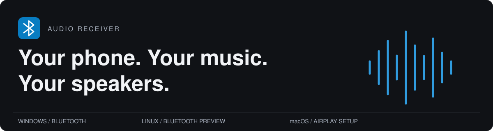
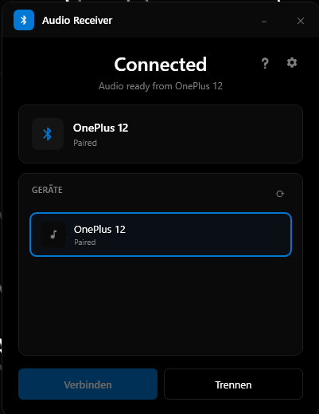

<p align="center">
  
</p>

<p align="center">
  <a href="https://github.com/Noxy229/BluetoothAudioReceiver/releases/latest"></a>
  <a href="https://github.com/Noxy229/BluetoothAudioReceiver/actions/workflows/release.yml"></a>
  <a href="LICENSE"></a>
</p>

<p align="center">
  Play your phone's audio through your computer's speakers.<br>
  Bluetooth reception on Windows and Linux. AirPlay setup on macOS.
</p>

<p align="center">
  <a href="https://github.com/Noxy229/BluetoothAudioReceiver/releases/latest"><b>Download</b></a> ·
  <a href="#getting-started">Getting started</a> ·
  <a href="docs/linux.md">Linux setup</a> ·
  <a href="https://github.com/Noxy229/BluetoothAudioReceiver/issues">Report a problem</a>
</p>

## Choose your edition

| Platform | What it does | Download from the latest release |
| :--- | :--- | :--- |
| **Windows 10 / 11** | Receives Bluetooth audio. Includes a tray icon, autostart and automatic connection to your last device. | `BluetoothAudioReceiver-win-x64.exe` |
| **Linux** · preview | Connects a paired phone through BlueZ and routes its audio to your speakers through PipeWire or PulseAudio. | `.deb`, `.rpm` or `.tar.gz` for `linux-x64` / `linux-arm64` |
| **macOS** · setup companion | Helps you enable Apple's built-in AirPlay Receiver. Audio playback is handled by macOS. | `osx-arm64` for Apple Silicon or `osx-x64` for Intel; filenames end in `AirPlay-Setup.zip` |

> [!NOTE]
> The Mac edition is an AirPlay setup companion, not a Bluetooth receiver. Linux support depends on your distribution's Bluetooth and audio configuration; the new Linux backend has automated tests but still needs real-device testing.

## Getting started

### Windows

1. Download the `.exe` from [Releases](https://github.com/Noxy229/BluetoothAudioReceiver/releases/latest). No .NET installation is needed.
2. Pair your phone in **Windows Settings → Bluetooth & devices**.
3. Open Audio Receiver, choose your phone and click **Connect**.
4. Start music on your phone. Use **Disconnect** when you're done.

Requires Windows 10 version 2004 or newer, an x64 PC and a compatible Bluetooth adapter/driver. Closing the window keeps the app in the tray by default; choose **Exit** in the tray menu to quit. Change this behavior in Settings.

<p align="center">
  
  <br><sub>Windows interface, captured in an earlier release.</sub>
</p>

### Linux

Install the package for your architecture and distribution, pair your phone in your desktop's Bluetooth settings, then open **Bluetooth Audio Receiver**.

1. Select your phone and choose **Connect**.
2. Start playback on your phone.
3. Choose **Play through speakers**. **Stop playback** removes the app's audio route.

The app uses your existing BlueZ and audio server. It does not replace them or change system configuration. See the [Linux setup guide](docs/linux.md) for Debian/Ubuntu/Mint, Fedora, Arch, openSUSE and portable installations.

### macOS

Extract the matching `AirPlay-Setup.zip`, open **Audio Receiver.app** and follow its setup steps. On a supported Mac, enable **AirPlay Receiver** in System Settings and select the Mac from your iPhone or iPad's audio output menu. See [Apple's AirPlay guide](https://support.apple.com/guide/mac-help/mchld7e543a0/mac) for compatibility and setup.

## About the downloads

Release builds include the .NET runtime. Windows binaries have no trusted publisher signature; Mac bundles are ad-hoc signed and are not notarized. The operating system may warn about an unrecognized developer. No Microsoft or Apple verification is claimed.

Each release includes `SHA256SUMS.txt`. You can compare a download's checksum with:

```powershell
# Windows PowerShell
Get-FileHash .\BluetoothAudioReceiver-win-x64.exe -Algorithm SHA256
```

```bash
# Linux — run beside the downloaded checksum file
sha256sum --ignore-missing --check SHA256SUMS.txt

# macOS — print a file's checksum, then compare it with SHA256SUMS.txt
shasum -a 256 BluetoothAudioReceiver-osx-arm64-AirPlay-Setup.zip
```

## Build from source

Install the [.NET 8 SDK](https://dotnet.microsoft.com/download/dotnet/8.0), then:

```bash
git clone https://github.com/Noxy229/BluetoothAudioReceiver.git
cd BluetoothAudioReceiver

# Run the platform-independent regression checks
dotnet run --project tests/Receiver.Tests.csproj -c Release

# Linux / macOS desktop edition
dotnet run --project Desktop/BluetoothAudioReceiver.Desktop.csproj
```

For the Windows edition, run these commands on Windows:

```powershell
dotnet run --project BluetoothAudioReceiver.csproj
dotnet publish BluetoothAudioReceiver.csproj -c Release -r win-x64 --self-contained true -p:PublishSingleFile=true -o publish
```

The release workflow builds Windows x64, Linux x64/ARM64 and macOS Intel/Apple Silicon. Linux packages are built on Ubuntu 22.04; macOS packages are built on macOS runners. The [`scripts/`](scripts) directory contains package scripts and optional local code-signing tools. Test certificates do not establish a trusted publisher.

## Troubleshooting & feedback

**No phone in the list?** Pair it in the operating system first and refresh. On Windows, check Bluetooth drivers; on Linux, follow the [audio setup checklist](docs/linux.md#no-audio).

**Music stutters or Wi-Fi slows down?** Try a 5 GHz Wi-Fi network, move the phone closer and check for Bluetooth driver updates.

**Found a bug?** [Open an issue](https://github.com/Noxy229/BluetoothAudioReceiver/issues) with your OS version, app version, Bluetooth adapter and the steps to reproduce it. For Linux, include your audio server and the error shown by the app. Windows crash logs are stored in `%LOCALAPPDATA%\BluetoothAudioReceiver\logs`.

[MIT license](LICENSE) · [Release notes](RELEASE_NOTES.md)
